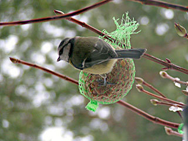

Poikani [Tuomas](http://irc-galleria.net/view.php?nick=travel) otti keittiön ikkunasta kuvia uudella kamerallaan, tässä sinitiainen:

Pihan lajeja tammikuussa:

- Talitiainen
- Sinitiainen
- Kuusitiainen
- Töyhtötiainen
- Varpunen
- Mustarastas
- Puukiipijä
- Kesykyyhky
- Varis
- Harakka
