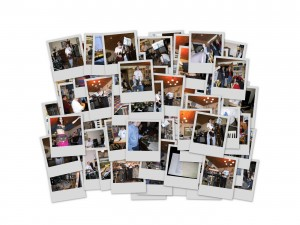

\[caption id="attachment\_1243" align="alignnone" width="300" caption="Ystävänpäiväkollaasi"\]\[/caption\]

Niin, ne ystävänpäiväbileetkin jo vietettiin Puistolassa 12.2.2005, enkä muistanut tehdä niistä heti blogiin merkintää. Juhlat olivat jo järjestyksessään kahdennettoista (12.) . Iso kiitos järjestävälle pariskunnalle, Merjalle ja Karille, jotka taas kerran valjastivat kotinsa hienojen juhlien näyttämöksi! Ohjelmassa oli perinteisesti erilaisia soitannollisia esityksiä sekä tällä kertaa yllätysvetona napatanssia. Oma bändimmekin tietty soitti sen vuoden melkein ainokaisen keikkansa. Tällä kertaa oli kuitenkin paljon muutoksia ohjelmistossa, joten oli mukava meininki, kun sai yllättää porukat uusilla kappaleilla. Vain kaksi coveria, loput omia biisejä.
