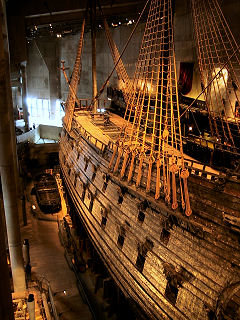

Pitkästä aikaa perheen kanssa laivalla Tukholmassa. Kävimme Vasa-laivaa katsomassa [Vasa Museet](http://www.vasamuseet.se):ssa. On se aivan uskomattoman hienosti säilynyt laiva. Vasa-laiva on maailman ainoa jäljellä oleva 1600-luvulla rakennettu laiva, niinkuin museon sivuilla sanotaan. Laivan ympärille rakennetussa museossa on laivan lisäksi hieno näyttely, jossa riittäisi paljon katseltavaa vaikka kuinka moneksi tunniksi.

\[caption id="attachment\_1248" align="alignnone" width="240" caption="Wasalaiva"\]\[/caption\]

Technorati link cosmos: [Tukholma](http://technorati.com/tag/tukholma), [Vasa-laiva](http://technorati.com/tag/vasa-laiva)
