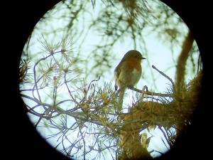

\[caption id="attachment\_1263" align="alignnone" width="300" caption="Punarinta kaukoputken läpi"\]\[/caption\]

Tuli huvikseen kokeiltua tuota kaukoputkea ja digikameraa kimpassa. Omistan jo vanhastaan Kowan ikivanhan kaukoputken, 25 kertaa suurentavan TS-601:n. Firmalta lainassa oli taas vaihteeksi tänään tuo 2.1 megapikselin Canon S-10, vanha lousku niin'ikään. Kotipihan männyssä lauleskeli punarinta melko lähellä parveketta, joten ei kun kokeilemaan. Kaukoputki Manfrotto-jalustalle, tarkennus, kamera okulaariin käsivaralta asetellen ja varovainen napsaisu. Hieman hieromista Paint Shop Pro 9:ssä, ja lopputulos yllä. Ei hassumpi käsivaralta ilman sen kummenpia apuvälineitä. Technorati Link Cosmos: [digiscoping](http://technorati.com/tag/digiscoping), [punarinta](http://technorati.com/tag/punarinta), [Erithacus Rubecula](http://technorati.com/tag/erithacus%20rubecula)
