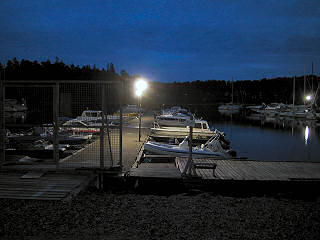

Edellisenä yönä oli vartiovuoron aika, melko hiljainen yö, muutama juhlija jaksoi koko yön, mikäs siinä, vene laiturissa on kuin kesämökki ilman automatkaa. Hyvää ruokaa, juomaa ja kavereita, kyllä sitä iltaa istuu mielellään itse kukin.

\[caption id="attachment\_1265" align="alignnone" width="320" caption="Vartiossa VVK"\]\[/caption\]

Hiljainen hetki laitureilla

Kestojuhlat, oikeammin rymybileet, ovat menossa aina tuolla Villa Ullaksen edessä olevalla nuotiopaikalla, melkoista meteliä, laulua, huutoa ja örinää, ei kovin mukavaa vieressä asuville.
