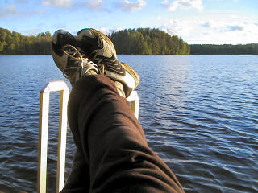

\[caption id="attachment\_1289" align="alignnone" width="320" caption="Loma-asento"\]\[/caption\]

Kun aloittaa loman ja heti lähtee pois perinteisestä miljööstä, niin pääsee heti ajatuksissaan irti arjesta. Tästä eteenpäin onkin tarkoitus harrastaa kohtuullisen runsaasti rentoa oloa. Juhannus tuli taas vietettyä perinteisesti mökillä Kirmustenjärven rannalla Sammatissa, mukana perheen lisäksi appiukkoni Sakke ja vanhimman pojan tyttöystävä Elisa. Technorati Link Cosmos: [Juhannus](http://technorati.com/tag/juhannus), [Sammatti](http://technorati.com/tag/sammatti)
