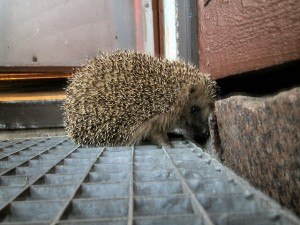

\[caption id="attachment\_1282" align="alignnone" width="300" caption="Siili"\]\[/caption\]

Samu-poikani on viime päivinä törmännyt eläimiin. Pari päivää sitten hän yllätti ketun jahtaamassa rusakkoa takapihalla, rusakko juoksi jalkojen välistä ja kettu melkein törmäsi poikaan. Tänään tullessaan illalla sisään äkkäsi hän siilin aivan kotiovella. Minä syöksyin tietysti kameran kanssa paikalle dokumentoimaan. Voi kun olisin saanut ketustakin kuvan, ne tuntuvat olevan yleisiä, sillä olen itsekin nähnyt jo kerran tänä kesänä ketun rusakko saaliinaan. Technorati Link Cosmos: [siili](http://technorati.com/tag/siili), [erinaceus europaeus](http://technorati.com/tag/erinaceus+europaeus), [Vuosaari](http://technorati.com/tag/vuosaari)
