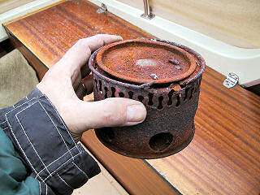

\[caption id="attachment\_1267" align="alignnone" width="320" caption="Vanha venekeitin"\]\[/caption\]

Vanha "säilykepurkki" -keitin on palvellut kaikenlaisilla retkillä jo 70-luvulta lähtien, jolloin ostin sen Partioaitasta muistaakseni kymmenellä mummon markalla. Monen monituiset linturetket se on ollut uskollinen keittön perusta, jonka avulla vatsa on saanut lämminä ruokaa. Tätä varmatoimisempaa keitintä en ole koskaan omistanut, erinomainen hinta, laatu ja kesto. Perheemme veneilyharastuksen alkaessa sai keitin alkaa toimimaan tilapäisenä venekeittiön ytimenä, sillä ostamamme veneen liesi oli puhkiruostunut. Meri-ilmasto on raakaa pellille. Keitin ruostui puhki ennenaikaisesti, harmi, vastahan se oli reilut 30 vuotta palvellut minua ;). Samanlaista ei ole löytynyt mistään, vaikka olen kauppoja kierrellyt ja etsinyt.
