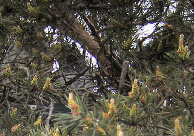
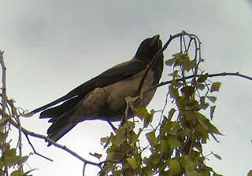

\[caption id="attachment\_1271" align="alignnone" width="320" caption="Variksenpojat lymyilevät pesässä"\]\[/caption\]

Kolme variksenpoikaa lymyilee piilossa oksiston takana pihamännyssä olevassa pesässä. Viittä vaille lentokykyisiä.

\[caption id="attachment\_1272" align="alignnone" width="320" caption="Emovaris vahtii"\]\[/caption\]

Emot vahtivat naapuripuissa.

Technorati Link Cosmos: [varis](http://technorati.com/tag/varis), [digiscoping](http://technorati.com/tag/digiscoping), [Corvus Corone](<http://technorati.com/tag/corvus corone>)
