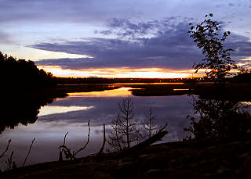

\[caption id="attachment\_1269" align="alignnone" width="320" caption="Saunalahti 2.6.2005"\]\[/caption\]

2.-3.6. välisenä yönä pyöräretki yölaulajien perässä. Ensin laiskasti metrolla Hertoniemeen, josta pyörällä: Herttoniemi - Saunalahti - Mölylä - Hakala - Arabia - Lammassaaren pitkospuut - Kyläsaari - Kulosaari - Herttoniemi - Roihuvuori - Marjaniemi - Vuosaari

Vanhankaupunginlahden rannoilta löytyi 42 satakieltä. Lisäksi viitakerttunen Mölylän reunalta, jota pääsi kuulemaan kivasti n. 5 metrin päästä. Lisäksi tavallisia kerttusia. Loppumatkalla Kulosaaresta eteenpäin vielä 19 satakieltä, joten niitä oli yhteensä 61, reilussa kolmessa tunnissa.

Technorati Link Cosmos: [Satakieli](http://technorati.com/tag/satakieli), [Viikki](http://technorati.com/tag/viikki), [Vanhankaupunginlahti](http://technorati.com/tag/vanhankaupunginlahti)
