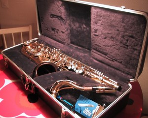
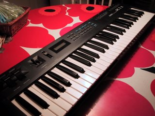

Nyt pitää saada itselleni vihdoinkin valioluokan elektroakustinen kitara. Sen rahoittamiseksi on luovuttava muutamasta muusta soittimesta, pitkin hampain. Siis uutta kotia etsivät:

tenorisaksofoni Selmer Bundy II Myyty! Hyviä soittohetkiä uudelle omistajalle!

ja syntetisaattori Kawai K1 II Myyty! Hyviä soittohetkiä tämänkin sympaattiselle ostajalle.

\[caption id="attachment\_1294" align="alignnone" width="320" caption="Kawai K1 II"\]\[/caption\]

Molemmat soittimet lisävarusteineen moitteettomassa soittokunnossa. Kiinnostuitko? Ota yhteys s-postilla: stedivee ät gmail piste com
