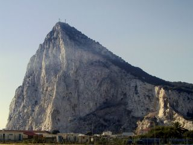
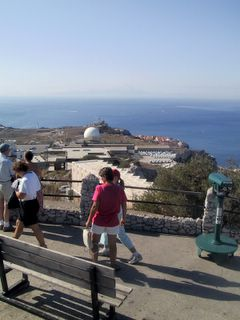
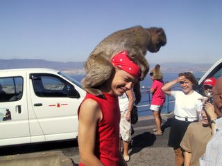
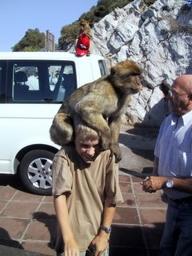
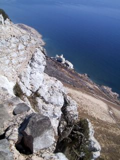

Keskiviikkoaamuna lähdimme ajelemaan kohti Gibraltaria. Auto jätettiin Espanjan puolelle ja kävelimme Britteihin.

\[caption id="attachment\_1307" align="alignnone" width="320" caption="Gibraltar Espanjasta katseltuna"\]\[/caption\]

Sieltä vuokrasimme kalliin, mutta niin mukavan minibussin ja matka huipulle saattoi alkaa. Wau mikä paikka! Eteläinen huippu - ja taustalla siintää utuinen Afrikka - matkaa ainoastaan 14 km.

\[caption id="attachment\_1308" align="alignnone" width="240" caption="Gibraltar - taustalla Afrikka"\]\[/caption\]

Sitten tietenkin apinoiden luokse.

\[caption id="attachment\_1310" align="alignnone" width="320" caption="Tuomas ja apina"\]\[/caption\]

\[caption id="attachment\_1311" align="alignnone" width="240" caption="Samu ja apina"\]\[/caption\]

Alas on pitkä matka.

\[caption id="attachment\_1312" align="alignnone" width="240" caption="Gibraltar - ja alas on 400m"\]\[/caption\]
