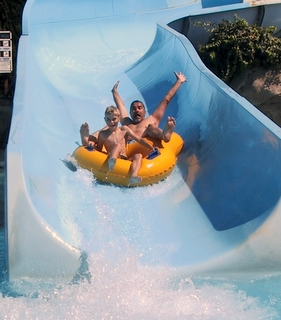
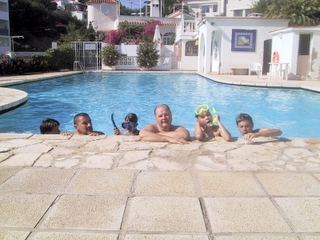
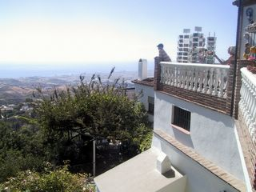

Lauantai ja sunnuntai on mennyt Fuengirolaan tutustuen junalla ja kävellen. Tutuksi ovat tulleet jo junakatu, bussikatu ja ennen kaikkea nälkäkatu, joka on täynnä ravintoloita. Maanantai oli pakkopullaa vesipuistossa.

\[caption id="attachment\_1303" align="alignnone" width="281" caption="vesipuistossa"\]\[/caption\]

Omassakin altaassa uitiin.

\[caption id="attachment\_1304" align="alignnone" width="320" caption="poolilla"\]\[/caption\]

Tänään tiistaina mukava visiitti vuoren rinteelle Mijas -nimiseen kylään.

\[caption id="attachment\_1305" align="alignnone" width="320" caption="Mijas ja Fuengirola"\]\[/caption\]
