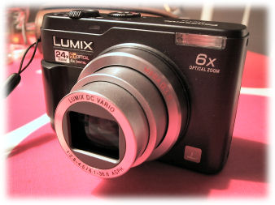

\[caption id="attachment\_1314" align="alignnone" width="338" caption="Uusi kamera"\]\[/caption\]

Hankimme vihdoin itsellemme digipokkarin, siis itselleni ja vaimolle. Pojilla olikin ennestään jo omansa. Hankintakriteereinä olivat

- pieni koko
- riittävästi optista zoomia
- tarpeeksi nopea

Nämä ominaisuudet toteutuivat mukavasi Panasonicin [Lumix DMC-LZ2](http://www2.panasonic.com/webapp/wcs/stores/servlet/vModelDetail?displayTab=O&storeId=15001&catalogId=13401&itemId=88142&catGroupId=24999&modelNo=DMC-LZ2&surfModel=DMC-LZ2&cacheProgram=11002&cachePartner=7000000000000005702) -kamerassa. Lisänä ominaisuuksissa kun oli tuo kuvanvakain, niin ei paremmasta väliä. Tämän pitäisi riittää kuvien perusnäppäilyyn.
