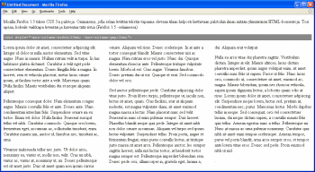

Todella mukavan tuntuinen uusi kettu. Paljon uusia ominaisuuksia, mm. tukea jo CSS 3:lle. Lue lisää tuliketusta ja lataa itsellesi oma [http://www.mozilla.org/projects/firefox/](http://www.mozilla.org/projects/firefox/).

\[caption id="attachment\_1325" align="alignnone" width="350" caption="Firefox ja CSS3 palstat"\]\[/caption\]

Mozilla Firefox 1.5 tukee CSS 3:n palstoja. Ominaisuus, jolla selain levittää sisällön vapaana olevaan tilaan helposti luettaviin palstoihin ilman mitään ylimääräisiä HTML-komentoja. Tosi upeaa!

`
Lorem ipsum... 
`
