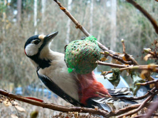

\[caption id="attachment\_1328" align="alignnone" width="320" caption="Dendrocopus Major - Käpytikka"\]\[/caption\]

Olin kerrankin hollilla ikkunan ääressä oikeaan aikaan. Tiirailin kameran kanssa ikkunan takaa tiaisia talipallon kimpussa, kun yllättäen käpytikkanaaras lennähti pallerolle. Sain siitä paljon kuvia, täytyy julkaista ne sivuilla, kunhan kerkiää hieman niitä editoimaan PSP:ssä. Tässä kuitenkin maistiaisia. Tag: [käpytikka](http://technorati.com/tag/käpytikka)
