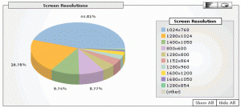
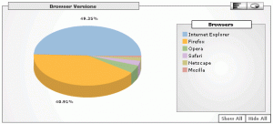
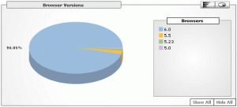

Parisen viikkoa on kulunut [Google Analytics](http://www.google.com/analytics/) -palvelua käyttäessä. Tässä muutama kuvakaappaus raporteista.

#### Resoluutiot

\[caption id="attachment\_1330" align="alignnone" width="300" caption="resoluutiot 11-2005"\]\[/caption\]

Tässä raportissa huomio kiinnittyy 800x600 resoluutioon, jonka osuus on vielä jopa lähes 9 prosenttia. On siis edelleen huomioitava ja testattava kaiken mahtuminen näin pienelle näytölle.

#### Selaimet

\[caption id="attachment\_1331" align="alignnone" width="300" caption="Selaimet 11-2005"\]\[/caption\]

Firefox ja IE ovat valtaselaimia lähes rinta rinnan tällä sivustolla vierailevien joukossa.

#### Internet Explorerit

\[caption id="attachment\_1332" align="alignnone" width="300" caption="IE:t 11-2005"\]\[/caption\]

IE-versioiden joukossa ei enää merkittävissä määrin ole ikivanhoja Windowsin 5-versioita. Tämä helpottaa hieman tulevan CSS-koodin tekemistä, sillä CSS-tiedostoissa ei tarvitse välttämättä enää käyttää liiallista määrää hackeja, joilla IE-selainten puutteellisen CSS-tuen myötä tulevat ongelmat saataisiin kuriin. Vielä ei ole [IE7](http://blogs.msdn.com/ie/) vieraillut täällä ;)
