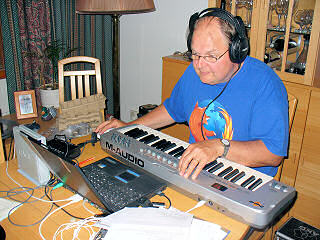
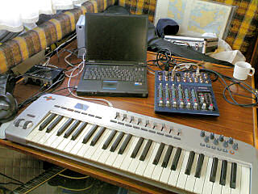

Musiikkia voi nykyään kätevästi tallentaa melko kannettavalla kalustolla, joka on parissa kassissa siirrettävissä tarvittavaan paikkaan. Pääasiassa pidän laitteistoani kotona, jossa muutamassa minuutissa on kannettava tietokone valjastettu digitaaliseksi nauhoitusasemaksi.

Hieman enemmän menee aikaa kun studion vie veneeseen, laitteet äänityskunnossa n. puolessa tunnissa. Veneellä on loistava työrauha ja hyvä fiilis. Ainoa rajoittava tekijä on se, että käytännössä on oltava laiturissa, jossa virtaa saa laitteille roikan avulla.

