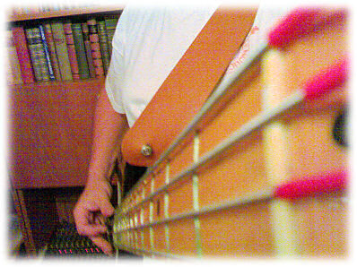

Edellisen helmikuun yli kymmenen vuoden perinteen omaavat varsinaiset ystävänpäiväbileet jäivät bändimme kitaristilta Karilta erinäisitä syistä järjestämättä. Niinpä hän järjesti näin elokuussa uudet bileet. Paikalla oli huomattavasti hillitymmin väkeä kuin aiemmin, vain 30-40 henkeä. Päällekkäisiä bileitä oli osanottajia karsimassa. Ruokaa, juomaa ja musiikkia - kivaa!

Muutama lisäkuva bändin kotisivulla [slowenough.blogspot.com](http://slowenough.blogspot.com "Slow Enough")

Slow Enough -orkesterimme ohjelmisto koostui omista ja lainatuista kappaleista.

Ensimmäinen setti

- Homework
- Fool
- Satelliittipurkki
- Sunny Afternoon
- It ain't right
- Pandora's Box
- Kardiologiaa
- Pieni tyttö
- It
- One Way Ticket

Toinen setti

- Ystävänpäivälaulu
- Nefer, Nefer, Nefer
- Devil
- Elimellinen
- Verikanto
- Arska's Blues
- All Right OK
- She's Note There
- Kova jätkä
- Wishing Well

ja vielä encorea

- Black Magic Woman - Musta nainen
- Rock Me Baby
- Mustang Sally
