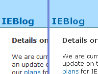
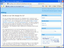
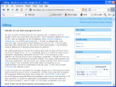

Ensi tuntumaa uuteen Internet Explorer 7 -selaimeen tuli lopullisesti tänään asennettuani lopullisen virallisen julkaisuversion. Toki heti tuli tarkistettua muutama itselle tärkeä www-sivusto - huokaus - mitään ei ollut varsinaisesti rikki, mikä helpotus! Uuteen käyttöliittymään on jo tullut beta- ja RC-vaiheissa tutustuttua, joten se ei ollut enää tyrmäys. Uusittu käyttöliittymä tulee kyllä tulee olemaan hyvin monelle tavalliselle peruskäyttäjälle iso yllätys.

No mikä ensimmäisenä uudessa selaimessa pistää käyttöliittymän lisäksi silmään - kirjasimet. Uudessa IE7:ssa on mielestäni jotenkin tunkkaisempi, paksumpi fontti kuin edellisessä versiossa saati sitten Mozilla ja Opera-selaimissa. Olisiko oletusfontin koko isompi kuin muissa selaimissa? 

Vasemmalla IE 7 ja oikealla Firefox 2

Varsinkin tavallisen leipätekstin paksuus yllättää, ei kovin siroa eikä kaunista. Otsikot sen sijaan piirtyvät siedettävästi, vaikka tietysti neikin ovat paksumpia kuin muissa selaimissa. Harmin paikka, täytyy säätää CSS-tiedostoa taas IE:lle erilaiseksi.

Ohessa kaappaukset 800x600 resoluutiolla Internet Explorer 7, Firefox2 ja Opera9 -selaimista. Mielestäni Operalla on onnistunein kirjasimen käsittely, jotenkin se on kaunein.  
