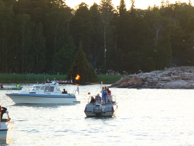
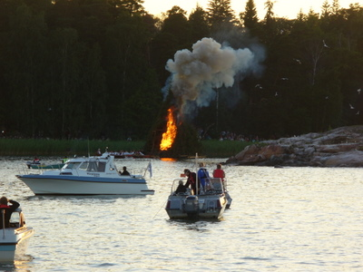
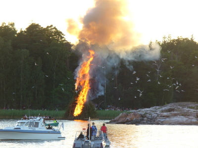
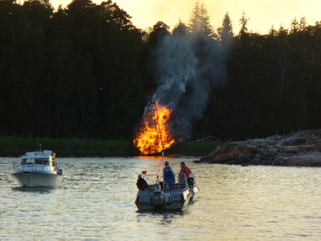
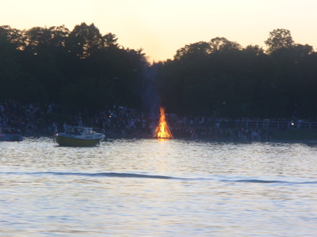
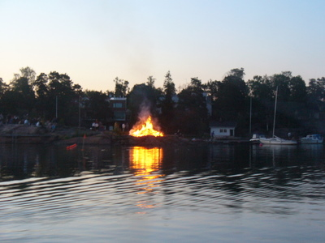
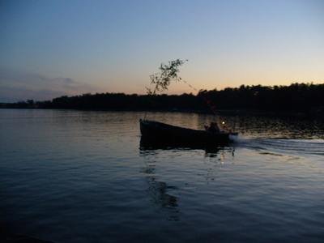
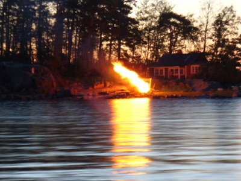

Vietimme todella urbaanin Juhannusaaton veneillen Helsingissä. Ensin alkuilta Seurasaaren edustalla ankkurissa ja ruokaa valmistaen. Siellä satojen muiden omissa veneissään sekä turistivesibusseissa kelluneiden seassa seurasimme erilaisten kokkojen sytytystä.

Kuvasarjassa se perinteinen Seurasaaren Juhannushääparin kirkkoveneestä käsin sytyttämä lautalla kelluva pääkokko.

Ja apuna oli varmasti ameriikan kiehisiä, sillä muutamassa sekunnissa liekit jo nousivat korkeammalle.

Ja alle minuutin kokko oli koko komeudessaan, ja naapurikallion lokit saivat kyytiä.

Mutta melko pian totuus valkeni. Heti kun päällisimmät oksat olivat palaneet, paljastui ruma lautakehikko, eikä kokko oikein enää vakuuttanut. Ruma se oli.

Melko pian auringon painuessa puiden taakse starttasimme takaisin itään. Paluumatkalla kohti Vuosaarta näimme monta mukavaa pienempää kokkoa.

Alla Kaivopuiston kokko.

Ja sitten Hevossalmen kokko.

Juhannustyyliä kalastajaveneessä.

Ja lopuksi Kallahdenniemen edustalla saaressa hieno kokko.

