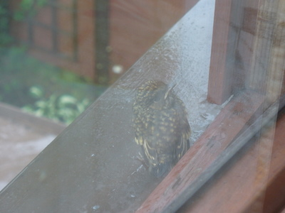
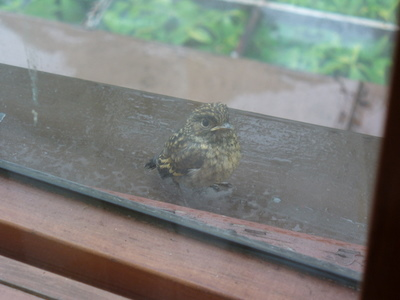
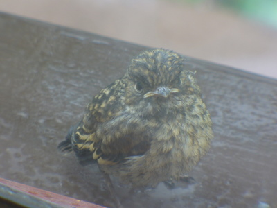

Pihakoivussa on asustanut kirjosieppo. Emot ovat olleet ihmisten suhteen pelottomia, etenkin koiras. Hyönteisiä on käyty napsimassa aivan jaloista puolen metrin päästä. Tänään oli sitten poikasten aika muuttaa pöntöstä kylmään maailmaan - heti vesisateeseen. Yksi poikasista valitsi ensilentonsa kohteeksi makuuhuoneemme ikkunalaudan, josta lasin läpi sain muutaman kuvan napsaistua ennenkuin se lennähti sireenipuskaan suojaan.

