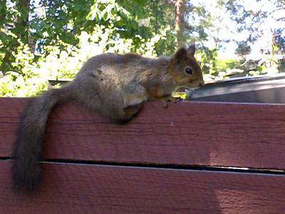

Pihalla asustelee useampiakin oravia, talvella niitä oli peräti neljä lintujen ruokinnalta tippuneiden pähkinöiden ja auringonkukan siementen kimpussa. Talven jäljiltä jäi pieni pussi auringonkukan siemeniä verannalle rulo-tyyppiseen leipälaatikkoon säilöön. Sen oli orava löytänyt, kun leipälaatikko oli joskus jäänyt auki. Pää pussissa ja herkkua naamariin. Ei auttanut, vaikka laittoi leipälaatikon kiinni, orava osasi nostaa sen auki ja pääsi näin taas siemenille. Koskahan ne oppivat avaamaan ovia?

