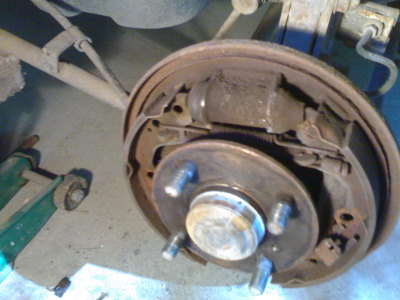
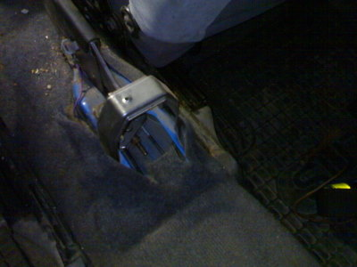
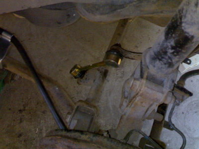

Suzukimme ei mennyt katsastuksessa läpi, ja matti on kukkarossa, niinpä oli käytävä itse puutelistan kimppuun. Olen kyllä aika tumpelo autonkorjaaja, onneksi on hyvä kaveri, joka neuvoo ja auttaa.

Ensin uudet jarrulevyt ja palat eteen sekä vasemmalle että oikealle. Aika helppo homma, yhteensä 40 minuuttia kului aikaa. Hyvät neuvot ja työkalut takasivat nopean suorituksen.

Sitten seuraavaksi selvästi kivuliaampi homma, toinen käsijarruvaijereista oli poikki. Siinä oli iso työ ensin irroittaa vanha vaijeri pois paikoiltaan, aika jumissa se oli rumpujarrun sisällä.

Selvästi helpompi oli laittaa uusi vaijeri paikoilleen, vaan eipä sekään kivutonta ollut. Tunti ei riittänyt tähän vaijerihommaan. Oli töitä auton sivulla, alla ja sisällä.

Sen jälkeen koiranluun vaihto, joka oli helppo nakki, kunhan ensin sai vanhan irti. Tässä jo uusi käsijarruvaijeri ja koiranluu paikoillaan.

Vielä jäi töitä, mutta onhan niitä päiviä myöhemminkin...

Varaosien hinnoissa on huimia eroja. Käsijarruvaijeri maksaa [Motonet](http://www.motonet.fi) -kaupassa 19,90 € ja sama merkkikorjaamossa ME-Autossa yli 60 €. Kannattaa katsoa mistä ostaa.
