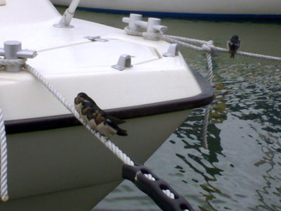

Venekerhon laiturien alla pesii joka kesä haarapääskyjä. Laiturinalus on suojainen paikka ja kun pesästä lähdön aika koittaa, on poikasille mukavia istumapaikkoja valittavana yllin kyllin, jossa voi odottaa mamman tuomaa ruokaa.
