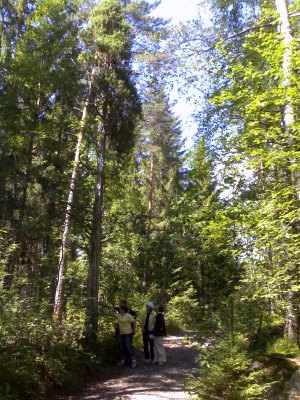
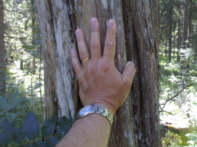
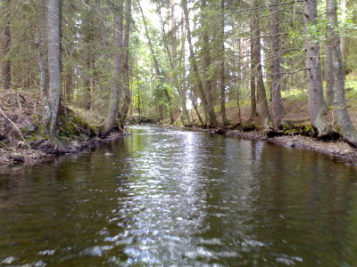
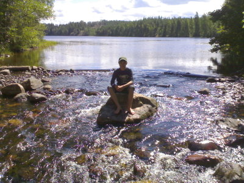

Karjalohjan Nummijärven seudulla kävelyretkellämme huomasimme valtavan katajan. Oli niitä muutamia muitakin suurikokoisia, mutta tämä oli tien vieressä ja pisin, mitä itse olen Suomessa muistaakseni missään tavannut.

Kataja oli ainakin kymmenen metriä korkea, sitä voi kukin itse arvioida kuvasta, jossa väki seisoo sen vieressä. Latva menee hieman kuvasta vielä yli.

Runkokin oli aika paksu.

Kävelymatkalla näimme myös lintuja, joita ei pääkaupungissa tapaa ainakaan helposti: pyy, teeri, kuikka ja palokärki.

Nummijärvi laskee juuri ja juuri soutuveneellä kuljettavaa kaunista "kanavaa" pitkin pieneen Sikajärveen. Lasku-uoma Sikajärvestä eteenpäin taas muodostaa pienen kosken.

