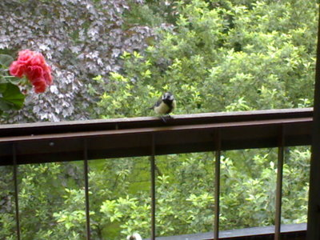

Haagassa anopin parvekkeella vierailee kesy talitiainen, joka ruokkii ahkerasti lentopoikasiaan. Tiainen on rohkea, syö kädestä ja vierailee ikkunasta sisällä keittiössäkin murusten toivossa. Saa olla kyllä tarkkana mitä jättää ruokaa esille. Anoppi on nimennyt sen Pirkko-Oskariksi, kun ei tiennyt onko se koiras vai naaras. Aika leveä musta rintavyö sillä oli, joten taitaa sitten kai olla Oskari?

Erikoisinta siinä kuitenkin on se, että tintti on päälaeltaan lähes kalju. Vain muutama haiven törröttää päälaella saaden aikaan hassun vaikutelman töyhtötiaisesta.

