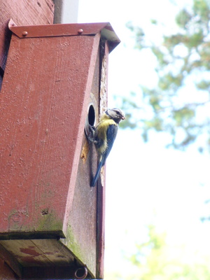

Alkukesän etupihan pöntössä pesi talitiainen. Kun se sai poikasensa maailmalle, otti pöntön käyttöönsä sinitiainen. 

Sinitiaispari ruokki nyt ahkerasti poikuettaan pöntössä, jota käpytikkanaaras kävi aiemmin pariinkin otteeseen yrittämässä ryövätä. Hieman vahinkoa se tikkanaaras kerkesi pöntölle tekemään, ennenkuin sain hätistettyä sen pois. Tikalle olisi maistunut varmaan pienet poikaset ja/tai munat.

Kaikilla linnuilla on omat poikasensa, joille emot yrittävät vimmatusti hankkia sapuskaa, elo on yhtä henkiinjäämistaistelua. Autosta näin aiemmin eilen venerannassa kun harakka yritti saada lennosta kiinni pikkulinnunpoikasta, joka räpisteli hädissään karkuun.
