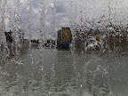

Vuosaaressa on Aurinkolahden reunalta mantereelle lähtevä lyhyt kanava, johon pumpataan vesi merestä. Vesi valuu takaisin mereen portaittain alaspäin. Yhdessä kohtaa on putouksen takana mahdollista myös kävellä, ja siis myös ottaa kuvia vaikkapa N70 kamerapuhelimella.

[Katso lisää putouskuvia täältä](http://picasaweb.google.fi/stedivee/AurinkolahdenKanavanVesiputous/photo#5084818953555694146). 
