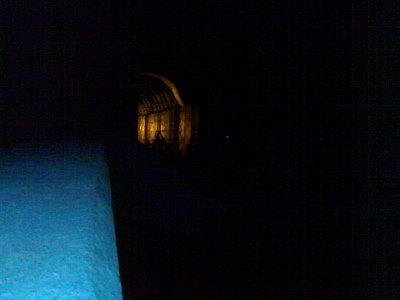

Pyöräretki itään: Aurinkolahti - Vuosaaren täyttömäki - Porvarinlahti - Kasavuori - Talosaari ja sitten pääpiirteissään samaa reittiä takaisin. Metsäosuuksilla oli jo aika pimeää ajaa, muutamissa paikoissa oli talutettava maaston takia. Kokonaismatka vaivaiset 26 kilometriä. Paluu puoli kolmen aikaan ja sitten veneelle nukkumaan.

Aavemainen junatunnelin suu Porvarinlahdella

Yölinnut ovat näin heinäkuun lopulla jo melko hiljaa, ei satakieliä yhtään matkalla. Nuolihaukka iltahämärissä Vuosaaren golfkentän reunalla. Takuuvarma kehrääjä Kasavuorella, jonka onnistuin myös kuulemisen lisäksi myös näkemään. Lehtopöllö puhalsi pari kertaa Talosaaressa, samoin ketun rääkäisyt sekä melko varma lentävä kehrääjä. Heinäsirkkoja. Ihme ettei yhtään lepakkoa sattunut matkalla silmiin. Hyttyset ovat tänä vuonnä vähissä.
