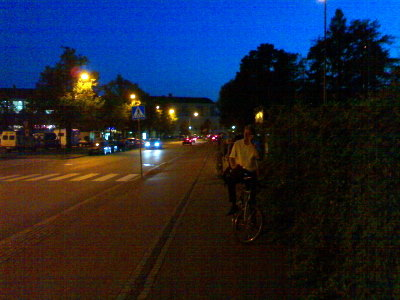
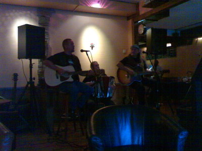

Pyöräillen taiteiden yössä ystäväni Tarmon kanssa.

Kävimme myös ravintola Fellowsissa kuuntelemassa Ile Hildenin kokoonpanoa (kaksi kitaraa ja hanuristi). Kokoonpanossa toista kitaraa soitti entinen bändikaverimme Naru Nyström (70-luvulta Double Trouble). Ohjelmisto pääosin hyvää suoraa simppeliä akustista bluesia.

Alla lyhyt ote soitosta nauhoitettuna N70 puhelimella.
