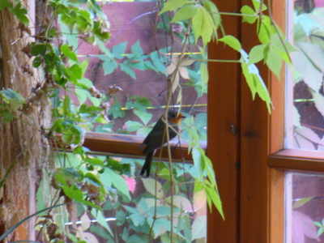
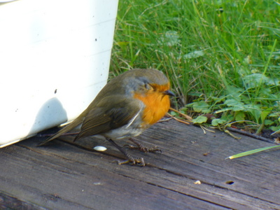

Ovi oli auki verannalle ja sieltä kuului rapinaa. Punarinta oli eksynyt avoimesta ovesta sisällä, eikä se enää osannut ulos kun ikkunoita oli niin paljon.

Niinpä sitä yritettiin varovasti jahdata ulos, mutta se lennähtikin kokonaan sisään vieraillen pari kertaa olohuoneessamme sekä keittiönkin puolella. Verhot äkkiä ikkunoiden eteen, ettei käy haaveria. Muutaman kerran se kuitenkin törmäsi verannan ikkunaan poistumistietä etsiessään ja lopulta pökertyi, jolloin se kannettiin varovasti ulos toipumaan.

Siinä se istui auringonpaisteessa huohottaen silmät uneliaasti raollaan juuri ja juuri pystyssä pysyen. Parikymmentä minuuttia kesti toipuminen, jolloin se sitten virkistyi ja lennähti reippaasti lähimpään puskaan. Kiva.
