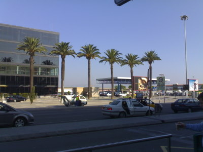
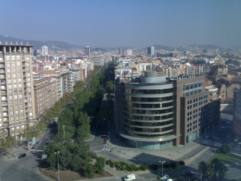
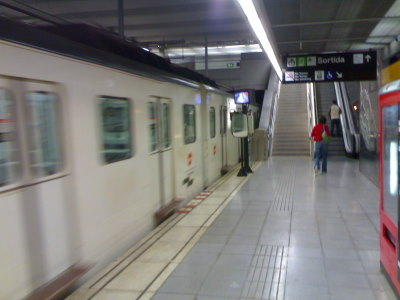
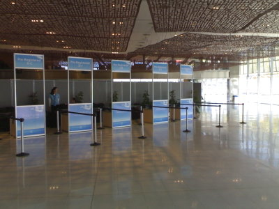
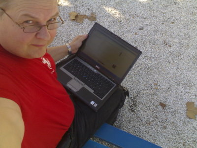
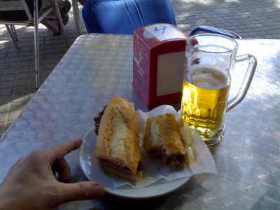
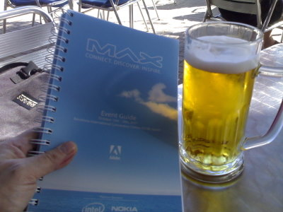
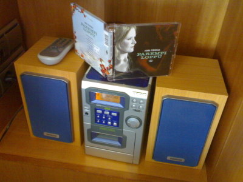
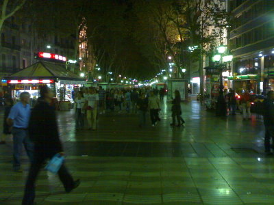

Aamuyöllä kun Helsingin Vuosaaresta starttasin, niin oli pari astetta pakkasta ja autojen ikkunat kuurassa.

 Barcelonan lentokentällä odottivat palmut, ei hassumpaa.

 Hotel Torre Catalunya ja 16. kerros

 Ensin automaatista kymmenen matkan lippu, reilu kuusi euroa. Lippu käy kaikkiin julkisiin kulkuvälineisiin. Sitten metroon. Sants Estación asemalta sinisellä L5 -linjalla Verdaguer -asemalle, jossa vaihto keltaiseen L4-linjaan ja suunta kohti itää La Paun suuntaan. El Maresme Fòrum -asemalla pois, ja se olikin jo aivan CCIB:n vieressä.

 Rekisteröitymään, vielä oli hiljaista.

 WLAN onneksi kyllä toimi jo pihallakin ja siinä sitten vaihdettiin kuulumiset messengerillä koko perheen kanssa Suomeen.  Sitten olikin jo kiljuva nälkä, onneksi vieressä oli kahvila ja sieltä sai evästä.

Hieman kerkesi tutustumaan materiaaleihinkin.

Hotellihuoneessa on ministereotkin, Jonna Tervomaan parempi loppu soi siis Barcelonan illassa. Päiväunet.

Illalla metrolla liikenteeseen Ramblasille, nälkä ajaa porsaan ulos hotellista.
