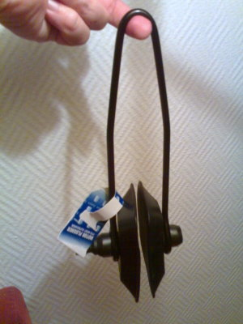

Mikkihiiri -korvalaput veneeseen.

Niin, mitä tavaraa oikeasti saa nykyään viitosella, siis ainakaan veneeseen? Kaikenlaiset tarvikkeet ja varaosat veneeseen on yleensä varustettu ylimääräisellä nollalla hinnan loppupäässä.

Koin positiivisen järkytyksen tänään kun ostin veneeseen huuhtelumuhvin, jonka avulla saa huuhdeltua ja ajettua glykoolin merivesipuolelle talveksi veneen ulkopuolelta vetolaitteen kautta. Ei enää äheltämistä konekopan alla letjuja irroittelemassa ja kiinnittelemässä :)

Niin, se siis maksoi viitosen. Siitä hyvästä teen linkinkin: [Waltic Oy](http://www.waltic.fi/), Herttoniemi.

p.s. Nyt 5.10. perjantaina tuli laitetta sitten kokeiltuakin. Roudarinteipillä muhvi kiinni tiiviisti vetolaitteen vedenottoaukkojen päälle, vettä hieman putkistoon valmiiksi yläkautta ja kone käyntiin. Huuhtelu oli helppoa ja nopeaa, suosittelen.
