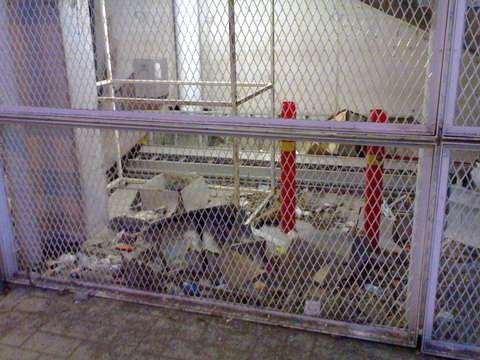
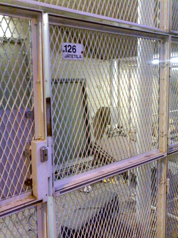
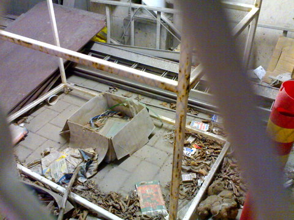

Eräs surkeimmista ja rumimmista paikoista Vuosaaressa on Metroaseman asemarakennuksen urheilutalon puoleinen alareuna, kohta josta portaat ja hissi nousevat ylätasanteelle. Portaiden alla on rautaverkkoaidan takana jonkinlainen varastotila, nimeltään 126 jätetila. Tila on nimensä mukainen. Epämääräinen röykkiö romua ja jätettä häkissä, joka on ollut koskematta ja siivoamatta jo useita vuosia, siis vuosia!!! Paikka on hienosti valaistu joten varsinkin iltaisin ohikulkijat näkevät tilan karmeuden.

Metroaseman ja sen liepeiden siisteys on muutenkin todella kehnoa luokkaa, hissikuilu on vaaleaksi maalattu ja lasitettu, joten kuilun sisäosan siivottomuus paistaa pahasti silmään. Alatason hissin edustan rikki potkitut rakenteet ja ikkunat saavat olla korjaamattomina vuosikausia, ketään ei tunnu liikuttavan. Suurimmat roskaajat ovat ihmiset itse, mutta Columbuksen alikulkutunnelissa lamppujen päällä asustavat pulutkin saavat aikaan osansa, tunnelin jalkakäytävä on useasta kohtaa paksun paskakerroksen sotkema, siitä on kiva ihmisten tallustella ja viedä tuliaisia kukin omaan kotiinsa. Harmittaa, kun menee muuten niin mukavan Vuosaaren maine ympäristön siivottomuuden takia.
