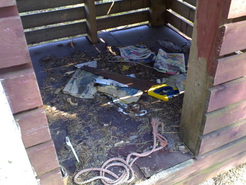

Vuoden ensimmäinen Pihlajaluodon reissu on hoidettu A-luokan makkaroiden kera.

  
  

Puukatos oli tyhjä, kaupunki ei vielä ole veneilykautta noteerannut. Onneksi oli omat sytykkeet mukana ja saaresta löytyi runsaasti pudonneita oksia maasta, näin saatin makkarat syöntikuntoon.

p.s.  
Liikuntavirastolta kerrottiin, että ensi viikosta alkaa grillikatosten varustelu, jäättömän talven takia eivät ole kyenneet kuljettamaan puita kuten normaalisti olisivat tehneet.
