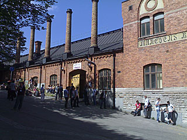
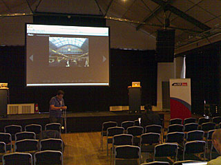

Adobe on AIR Tour pidettiin vanhassa panimorakennuksessa. Munchen Bryggeriet sijaitsee Torkel Knutsonsgatan 2:ssa aivan keskustassa. Lämmintä on, nythän on kesä.

Vielä on hiljaista ennen sessioiden alkua. Sessiot olivat tuttujen Adoben evankelistojen pitämiä, kuten Mike Chambers, Kevin Hoyt, Daniel Dura jne. Aiheet olivat melko yleisiä aina perusteista tietoturvaan saakka. Hyvä päivän paketti.

Viimeinen esitys jäi osin näkemättä, mutta oli ehdittävä kiireellä taksilla laivaan, aika tiukalle meni, sillä ruuhkaa oli tolkuttomasti.
