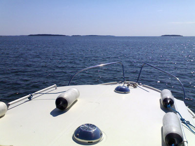
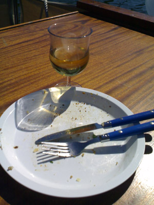
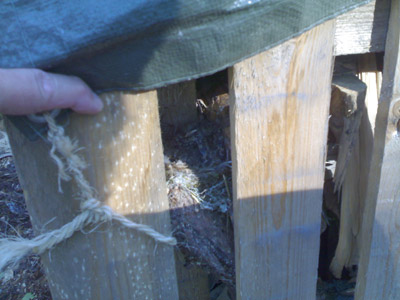

Merelle hellepäivän koittaessa, suuntana itä.

Sipoonselkää pitkin ensin Kaivokariin kahville, sieltä sitten aika pian tuulen vuoksi Onaksen Edeniin suojiin ja ruokaa tekemään.

Leivitetyt ahvenfileet salaattipedillä, ah, niin kaikki syötiin. Sitten suuntana Hitå, Sipoonjoen suulle tutun luokse kahville.

Harmaasieppo oli tehnyt pesän kaverin puuvajaan, poikaset ovat erinomaisella suojavärillä varustettuja.
