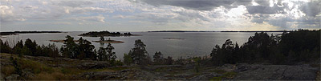
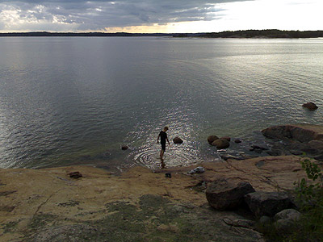
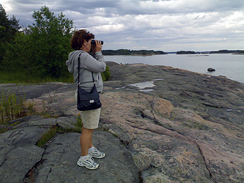
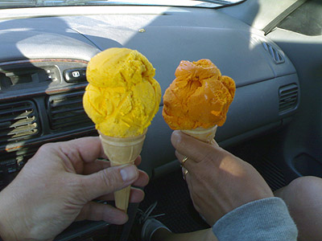

Ulkoiluretkellä [Inkoon Kopparnäsissä](http://www.uudenmaanvirkistysalueyhdistys.fi/index.php?k=13399).

  
Mahtavat maisemat Rävbergetiltä merellä. Napsauta kuvaa, niin näet koko panoraaman isompana kuvana.

Myös Berguddenissa oli mukavan näköistä.  
  
  
  
Ja lintujakin nähtiin.

  
Paluumatkalla oli pakko käydä Kaivopuiston jäätelökioskilla
