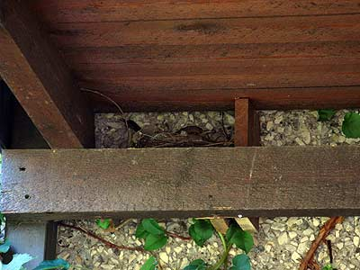

Laitoin jo aiemmin vinosti kotimme ulko-oven yläpuolelle pari lautaa pesänpidikkeeksi. Nyt on mustarastas hyväksynyt paikan pesäkseen. Matkaa ulko-oveen on alle metri.  
  
  
  
Koiras on välillä tosi aktiivinen puolustamaan pesää. Jos jää liian pitkäksi aikaa pesän alle, niin koiras lentää viuhahtaa aivan pään vierestä. Naaras taasen ei juurikaan välitä, vaikka ovesta kuljetaan päiväsaikaan edestakaisin, se hautoo vaan. Se luottaa piiloväriinsä ja sitten sillä on hyvät hermot.
