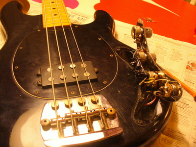
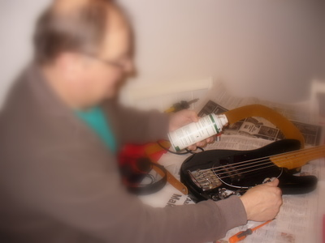
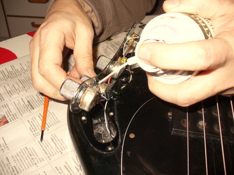
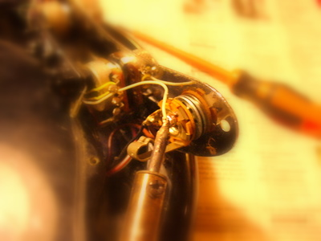

Musari on oikutellut viimeisien treenien aikana siten, että yht'äkkiä ääni katoaa. Aluksi sitä epäilee rikkinäistä piuhaa, mutta kun piuhojenkaan vaihto ei ongelmaan tuonut ratkaisua, oli alettava tarkempaan syynäykseen.

Ensin konepelti auki.  

Sitten puhdistusspraylla hommiin.   
Kaikki potikat puhtaaksi.   
Rutinat loppuivat, mutta pätkiminen ei, hmm...

Kaikki piuhat oli nyittävä, ja löytyihän yksi kehnosti kiinni oleva. Siispä kolvilla kiinni.   
Kunnossa on!  
Onneksi korjaamo on omassa keittiössä ;)
