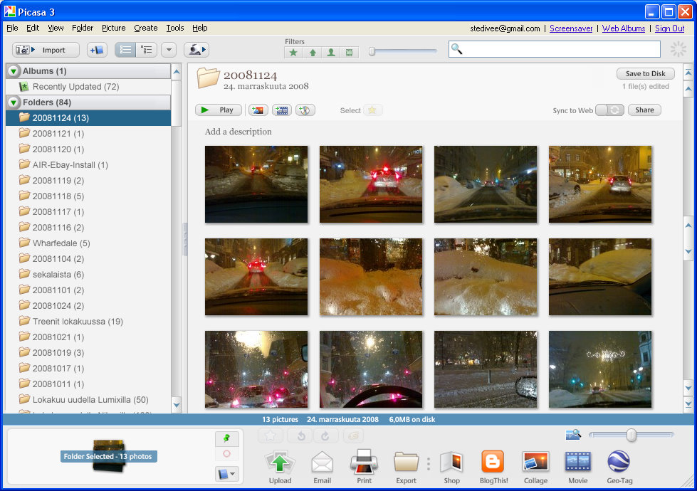

Huomasin hieman jälkijunassa, että Pisasa -kuvankäsittelyohjelmasta on ilmestynyt jo lokakuussa uusi versio 3.0. Itse pidän ohjelmasta sen nopeuden ja helppokäyttöisyyden takia ja käytän sitä pääasiallisesti julkaistessani kuvia tänne blogiini. Toki käytän myös melko paljon Photoshoppia, eihän sitä päihitä tietenkään mikään kun haluaa tehdä ammattimaisesti kuvankäsittelyä, mutta tämä blogihommahan on vaan harrastusta.  

Lisätietoja ja ilmaisen ohjelman lataus on osoitteessa [http://picasa.google.com/](http://picasa.google.com/).
