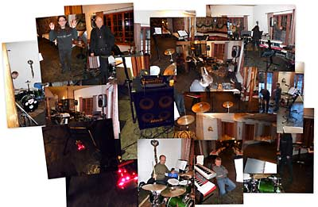
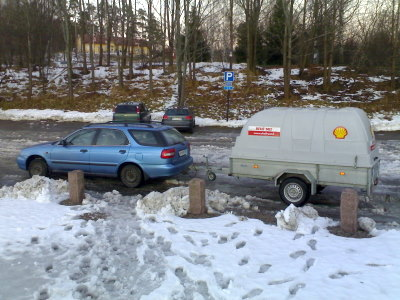

Slow Enough keikkailee harvakseltaan, onneksi kuitenkin joka vuosi ;) , nyt olimme viihdyttämässä kosketinsoittajamme työpaikan Pikku-Jouluissa. Mahtavat ruuat Viilatehtaalla Vantaankosken äärellä. Paikkakin oli viihtyisä ja porukka mukavaa.

Ohjelmistossa oli koko liuta kappaleita:

- Homework
- Many Years Gone
- Sunny Afternoon
- Handle With Care
- Pieni Tyttö
- Pandora's Box
- Devil
- All Your Love
- Fool
- Paint It Black
- Honky Tonk Women
- Love Portion Nymber Nine
- Shaking All Over
- Misunderstood
- Mustang Sally
- One Way Ticket
- Wonderful Tonight
- I Loved Another Woman
- Two Trains Running
- So You Found Your Way
- Oh, Pretty Woman
- You Really Got Me
- It Ain't Right
- Kardiologiaa
- Move Over
- She's Not There
- Kova Jätkä
- Black Magic Woman
- Rock Me Baby
- Wishing Well
- All Right OK
- Satelliittipurkki
- Johnny B Goode

Lisäksi säestimme "sika" -kappaleessa, jonka tähdet olivat tietysti firman omaa henkilökuntaa.

Uljas keikkabussimme:  

