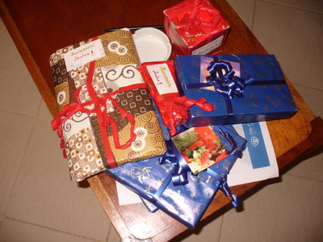
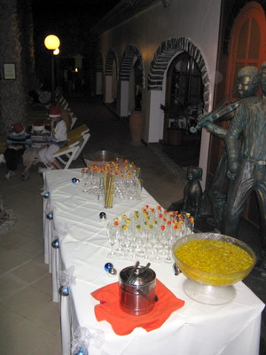

Olimme ensimmäistä kertaa poissa Suomesta Joulun aikaan ja jännitimme hieman osaako Joulupukki tänne...  
mutta ei hätää, tietäähän se pukki, missä kiltit lapset luuraa.  

Ravintolassa Jouluillallinen alkoi drinkkihetkellä uima-altaan reunalla  
  
Sitten ravintolaan syömään erilainen Jouluateria; hanhenmaksapalleroita, grillattua hummeria, liekitettyjä banaaneja ja jäätelöä - ei paha.
