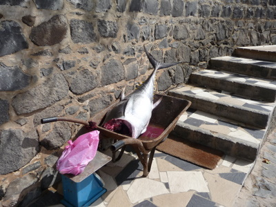
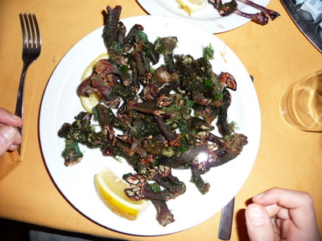
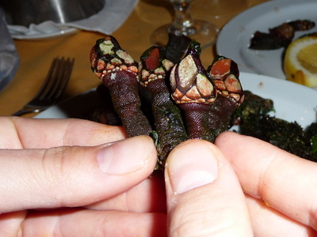
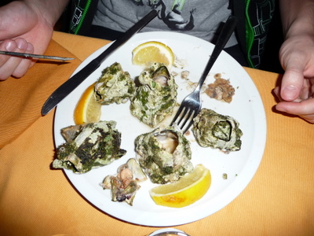
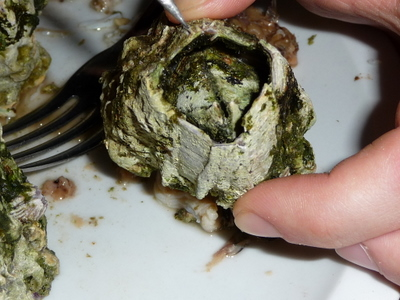
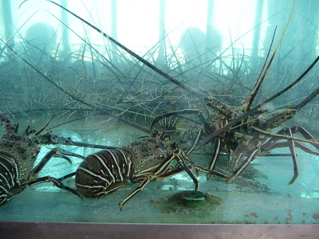

Ruokailimme usein omassa hotellin ravintolassamme, joka oli todella laadukas. Tonnikala oli tuoretta, sillä sitä tuotiin lähes joka päivä suoraan kalastajalta kottikärryllä keittiöön. Ruokalistalla oli useita herkullisia tonnikala-annoksia.  

Alkuruo'aksi löytyi eksotiikkaa, mm. Sea Fingers ja Cracas  
  
  
  
  
  
  

Jouluillan ateriamme oli vielä tässä vaiheessa elossa  

