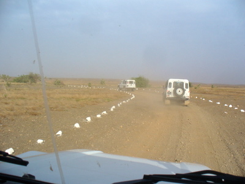
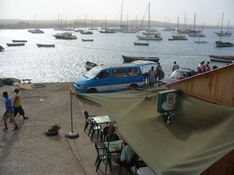
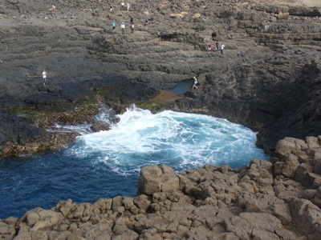
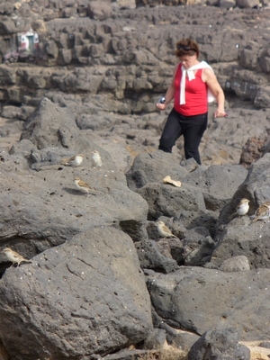
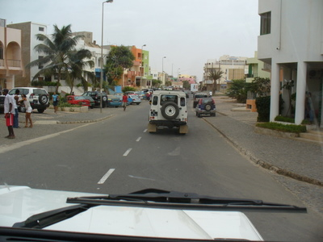
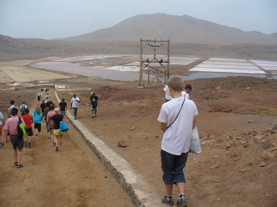

Retkelle jeepeillä ympäri Salin saarta, off-road. Kapverdenvarpusia ja taas uusia lintulajeja: kirjosiipikiuru (Alaemon alaupides) ja arokorppi (Corvus ruficollis).  

Kävimme Salin länsirannalla Palmeiran satamakaupungissa, jonka kautta tavaraliikenne pääosin kulkee.  

Länsirannalla Buraconassa oli myös karun hauska lahdelma, jossa vesi muodosti puolen päivän aikaan turkoosin silmän. Paljon kapverdenvarpusia.  
  

Pysähdyimme myös saaren keskellä lentokentän vieressä olevaan Espargosin kaupunkiin. Pikalounas ja uudestaan matkaan.  

Suolatehtaalla Pedra de Lumessa, joka taisi olla vanha kraateri. Siellä oli altaita jotka täytettiin merivedellä. Kuivatuksen jälkeen saatiin suolaa. Osa porukasta ui suolalätäköissä.  

