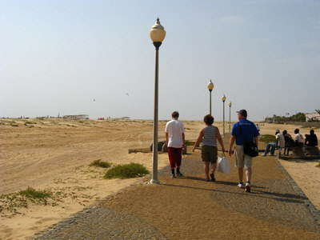
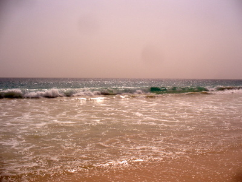
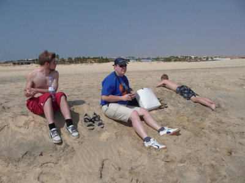
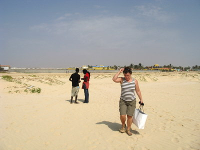

Lähdimme länteenpäin kävelylle suuntana kaukaa iltaisin vilkuttanut majakka. Alkumatka sujui helposti kävelytietä, mutta sitten alkoi hiekassa tallustelu.  

Aallot olivat paikoitellen mukavia, porukkaa oli surffailemassa purjeilla ja ilman  

Välillä oli pakko pysähtyä juomaan ja lepäämään, lämmintä oli.  

Monessa paikassa oli Senegalista tulleita kauppamiehiä ja naisiakin. Hello mister, nice family, come to my office, hello playboys jne. huudahdukset tulivat tutuiksi. Ja ostaa olisi pitänyt kaikenlaista "special price for you", hohhoijaa...  

