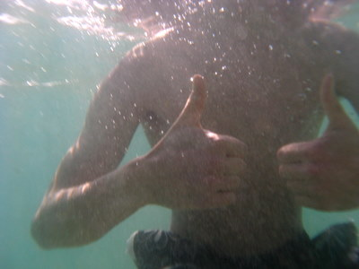
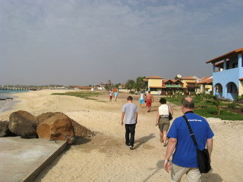
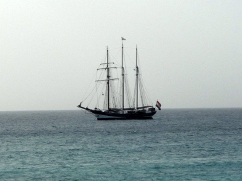
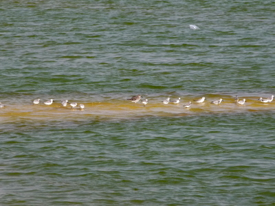

Kokeiltavana tietysti heti kameraan hankittu sukelluspussi, joka osoittautui kohtuulliseksi apuvälineeksi. Eihän se käytettävyydeltään kummoinen ollut, mutta kamera säilyi kuivana, ja kuviakin sai  

Pienelle tutkimusmatkalle Santa Mariaan ja samalla matkatoimiston infotilaisuuteen.  

Hotellin edustalla oli ankkurissa iso purjealus  

Jo tulopäivänä tuli linnuissa ensimmäinen elämänpinna: kapverdenvarpunen (Passer iagoensis), niitä on täällä joka paikassa. Hotellin aamiaisella tuli jatkoa, kun ruskosuula (Sula leucocaster) kalasteli komeasti syöksyillen hotellin edustalla. Hotellin vieressä on lehmähaikara (Bubulcus ibis) nappailemassa hyönteisiä uimarannan ja rakennusten välisellä alueella. Kesykyyhkyjä (Columba livia) näkyy siellä täällä muutamia yksilöitä. Silmiinpistävää on kuitenkin yleinen lintujen vähyys tällä karulla hiekkasaarella, ei lokkeja eikä vesilintuja vaikka ollaan meren rannalla. Rakennustyömaalla vesijättöaltaalla sentään oli kahlaajia. Mustajalkatyllejä (Charadrius alexandrinus) ja erikokoisia sirrejä muutamia kymmeniä. Pulmussirri (Calidris alba)oli yleisin sirri.   
  
Voi kuinka ruosteessa sitä onkaan lintujen tuntemisessa :(
