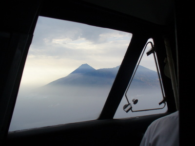
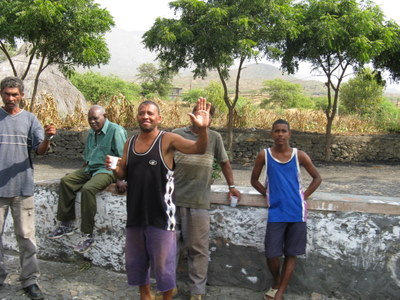
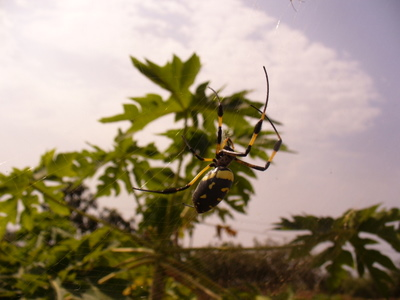
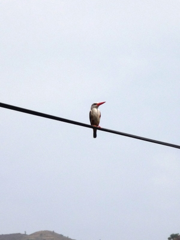
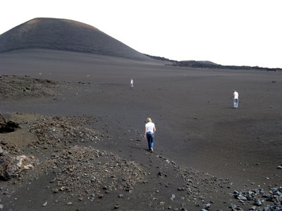
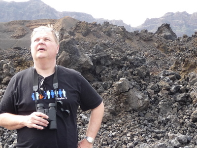

Aikaisin aamulla ylös ja 6:30 nouto hotellilta lentokentälle. Suuntana tulivuorisaari Fogo, joka on 55 minuutin lentomatkan päässä Salilta lounaaseen. Matkaa tehtiin 19 -paikkaisella pikkukoneella.  

Mystisen näköinen tulivuori ilmestyi sumun ja pilvien keskeltä.  

Olimme taas minibussilla liikenteessä, ensin aamiaiselle juustoa ja marmelaadia syömään, kiersimme kaupungilla ja torilla. Mainio paikallinen opas kertoili koko ajan faktoja Fogosta ja Kap Verdestä.  
  
Sitten matkasimme ylös kohti toimivan tulivuoren kraatereita. Edellinen purkaus oli 1995. Saaren paikallinen väestö oli oikein ystävällistä. Koko päivän aikana emme nähneet muita turisteja emmekä tungettelevia Senegalilais-kauppiaita, miten rentouttavaa. Tämä saari on jopa vehreä verrattuna Saliin.

Ylempänä saaren rinteillä kasvatetaan mm. papuja, kahvia, banaaneja ja mangoa. Teiden varret olivat täynnä hämähäkin seittejä ja tätä isoa keltaista hämppyä piti varoa!  

Matkan varrella tiirailtiin tietysti myös lintuja. Tuulihaukka (Falco tinnunculus)oli tosi yleinen, niitä oli saarella eri alalajejakin, tosin minä en niistä kerinnyt ottaa selvää. Uusia lajeja tuli taas haltuun: kapverdenkiitäjä (Apus alexsandri) ja tosi yleinen, värikäs harmaapääkalastaja (Halcyon leucocephala), josta kuvakin.  
  
Samu näki jonkin ison kalkkunan näköisen linnun, taisi olla paikallinen helmikana (Numida meleagris), minulta se meni ohi.

Lopulta kapusimme n. 1600 metrin korkeuteen suojelualueelle, tulivuoren kraateriin. Täällä oli lukuisia huippuja eri aikoina tapahtuneista purkauksista, myös tämä viimeisin 1995 purkautunut. Viimeisimmän yllätyspurkauksen jälkeen oli varoitusjärjestelmät asennettu paikoilleen. Näkymät olivat jylhät ja käsittämättömän karut. Väistämättä tuli mieleen Taru Sormusten Herrasta ja Mordor, vain Sauronin silmä puuttui ;)  
  
  
  
Ei näy egyptinkorppikotkaa, vaikka sen pitäisi pesiäkin saarella.

Söimme ylhäällä maittavan lounaan ja sitten takaisin alas, olihan jarrut kunnossa...  
Mahtava retki!
