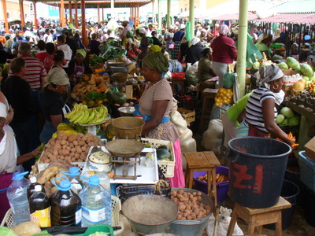
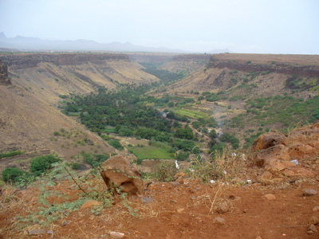
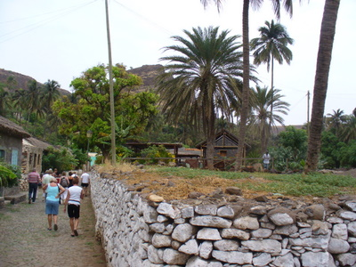
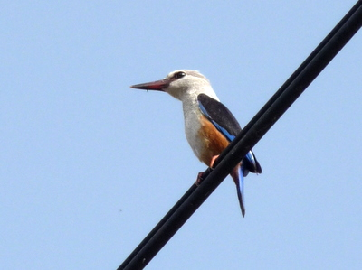
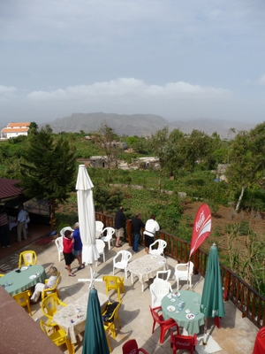

Toinen retki alkoi samaan tapaan 6:30 noudolla lentokentälle. Nyt oli suuntana Kap Verden pääsaari Santiago, joka on 45 minuutin lentomatkan päässä, Fogon vieressä. Sama pikkukone, co-pilottina samoin eilinen ihastuttava Cindy, kapteeni oli vahtunut.

Minibussilla liikenteeseen tällä kertaa erinomaisen naispuolisen oppaan johdolla. Kiretelimme pitkin pääkaupunkia ja vierailimme vihannestorilla ja paikallisessa konditoria-kahvilassa aamupalalla.  

Sitten linnoitukselle jyrkänteen reunalle, taas paljon tuulihaukkoja  

Linnoitukselta alas rannalle kylään, jonne aikoinaan orjat tuotiin. Heikkokuntoisimmat jätettiin Kap Verdelle ja he asustivat mm. näissä vieläkin asuinkäytössä olevissa Rua de Banana -kadun taloissa.  

Sitten matkasimme taas vuorille syömään. Tämä saari on vehrein näistä, joissa vierailimme. Yleisin lintu täälläkin kapverdenvarpusen rinnalla on harmaapääkalastaja  
  
Bussista näin minäkin todennäköisesti tuon "kalkkunan" helmikanan, en kerinnyt saamaan kiikareita silmille, vuorilla taas uudestaan arokorppeja sekä kapverdenkiitäjiä, noita paikallisia tervapääskyjä. Ylhäällä jylhissä maisemissa nautimme taas kerran maittavan lounaan.  
  
Sitten olimme taas valmiita palaamaan lentokoneella kotisaarellemme Saliin.
